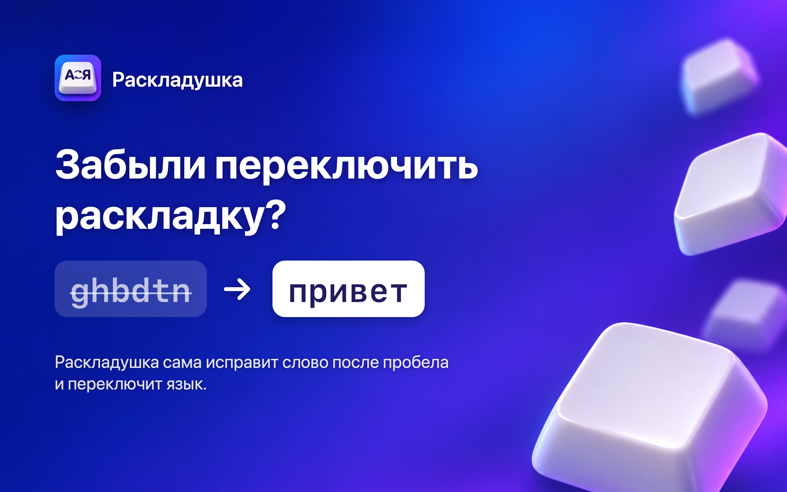

# Раскладушка



Утилита для строки меню macOS: исправляет текст, набранный не в той раскладке, и переключает язык.

- **Автопереключение** — после пробела слово вроде `ghbdtn` заменяется на «привет», раскладка переключается.
- **Сочетание клавиш** (`⌃⇧Space`, меняется в настройках) — переводит выделенный текст; без выделения —
  последнее набранное слово; сразу после автозамены — отменяет её и запоминает слово как исключение.
- **Меню** — включение и выключение обеих функций, исключение для текущего приложения, запуск при входе, выход.

Работает в App Sandbox, без сети и без собственных словарей (слова проверяет системный спеллчекер).

## Сборка

Нужны Xcode 15+ и [XcodeGen](https://github.com/yonaskolb/XcodeGen). Проект Xcode генерируется, в git его нет.

```bash
export DEVELOPMENT_TEAM=XXXXXXXXXX                # ваш Team ID из аккаунта разработчика Apple
xcodegen generate
(cd Packages/SwitcherCore && swift test)          # тесты ядра
xcodebuild -project Raskladushka.xcodeproj -scheme Raskladushka -derivedDataPath build build
open build/Build/Products/Debug/Raskladushka.app
```

При первом запуске откроется окно: нажмите «Разрешить…» и включите Раскладушку в
«Системные настройки → Конфиденциальность и безопасность → Универсальный доступ».

## Устройство

| Где | Что |
| --- | --- |
| `Packages/SwitcherCore` | Чистая логика без системных вызовов: таблицы раскладок, детектор, сессия набора, перевод выделения. Покрыта тестами. |
| `App/Sources/InputSources.swift` | Раскладки macOS: таблицы символов через `UCKeyTranslate`, переключение через `TISSelectInputSource`. |
| `App/Sources/KeyboardTap.swift` | `CGEventTap` в режиме «только чтение». |
| `App/Sources/TextInjector.swift` | Синтетические нажатия: стирание, набор, ⌘C / ⌘V; сохранение буфера обмена. |
| `App/Sources/HotKey.swift` | Глобальное сочетание через Carbon (разрешений не требует). |
| `App/Sources/AppState.swift` | Настройки, разрешения и связка всего вместе. |
| `Tools/` | Генерация иконок, скриншотов, статистики триграмм; сборка релиза. |
| `AppStore/` | Тексты, заметки для ревью, политика конфиденциальности, скриншоты, параметры экспорта. |

Как детектор решает, что слово набрано не там:

1. Слова от 4 букв: набранное не является словом своего языка, а «перевод» в другую раскладку — является
   (системный словарь; для слов вне словаря — статистика сочетаний букв).
2. Короткие слова проверяются по встроенным спискам частых слов, потому что словарь к ним слишком снисходителен.
3. Сомнительные короткие слова («z» → «я») исправляются задним числом, когда следующее слово подтверждает ошибку.
4. Не трогаются: слова с цифрами, camelCase, адреса, слова-исключения, поля паролей, приложения из списка исключений.

Таблица допустимых сочетаний букв (`TrigramData.swift`) — статистика, посчитанная скриптом
`Tools/make_trigrams.py` по `/usr/share/dict/words` и русскому списку слов из проекта
[SwitchFix](https://github.com/rundax/SwitchFix) (в README заявлена лицензия MIT, файла LICENSE в репозитории нет).
Сами слова в приложение не входят. Код других проектов не использован.

Известные ограничения: исправление срабатывает по пробелу (не по Enter и не по Tab); выделение переводится
через буфер обмена (⌘C → ⌘V), его содержимое потом восстанавливается; в полях с автодополнением (адресная
строка браузера) стирание может задеть подсказку.

## Отладочные режимы (только Debug)

```bash
APP=build/Build/Products/Debug/Raskladushka.app/Contents/MacOS/Raskladushka
$APP --selftest                      # что видит приложение в песочнице: раскладки, словарь, примеры замен
$APP --selftest --pairs --system     # ещё перебор двухбуквенных слов, автозапуск и смена раскладки
$APP --render --light --demo         # снимок окна настроек в PNG (путь печатается)
swift Tools/make_screenshots.swift Design/backgrounds <окно.png> Design/icon-source.png ru AppStore/screenshots
```

## Публикация в App Store

Скопируйте `Tools/appstore/config.example.env` в `Tools/appstore/config.env` и впишите свои значения
(файл и ключи в git не попадают). Дальше — `AppStore/CHECKLIST.md`.

## Лицензия

MIT, см. `LICENSE`. Иконка и фоны скриншотов сгенерированы нейросетью.
